Image de base:

## Exercice 1: image verte (pouet vert):
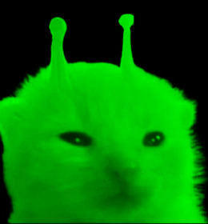
pas vraiment eu de difficulté
## Exercice 2: echanger les canaux(pouet swap):
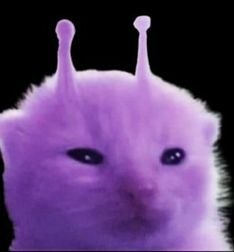
pas non plus eu de difficulté
## Exercice 3: noir et blanc(pouet 1967):
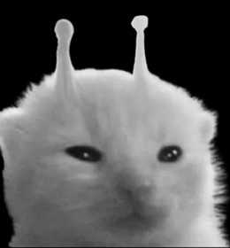
pareil que précédemment
## Exercice 4: négatif(deprepouet):
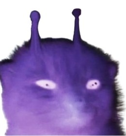
pareil que précedemment
## Exercice 5: degrade(variante plus dur du nom de thechoosenpouet):
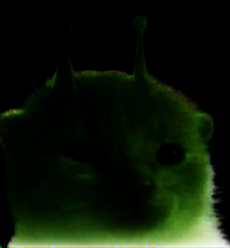
pour cette exercice je n'ai réellement réalisé ce qui était demandé: en faite j'ai d'abors fait l'exercice luminosite et me suis dit que plutot que de realiser un degrade noir/blanc je pouvais realiser un degrade clair/obscure sur une image (faisant un contraste de luminosite/ sortie des ténebres)cela m'a demande un peu plus de reflexion mais c'etait interessant à imaginer
## Exercice 6: miroir(teuop):
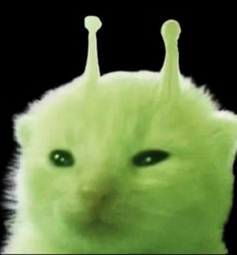
pas eu de difficulté
## Exercice 7: image bruitee(pouetneige):
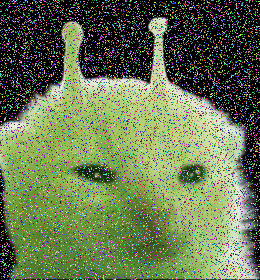
pas eu de probleme particulier mais ca ma permis de manipuler et de comprendre mieux la fonction random(en plus de mieux comprendre egalement les vec3 et comment fonctionne les pixels)
## Exercice 8: rotation de 90°(cote pouet):
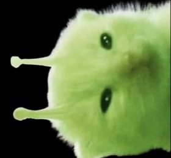
j'ai eu du mal à comprendre comment faire la rotation ce qui m'a meme emmener a creer la symetrie mais en diagonale(diagopouet) mais apres cela et un peu de réflexion je l'ai reussi
## Exercice 9:RGB split(tripouet):
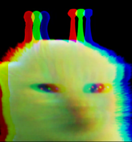
pas de probleme particulier
## Exercice 10:Luminosite(darkpouet et flashpouet):
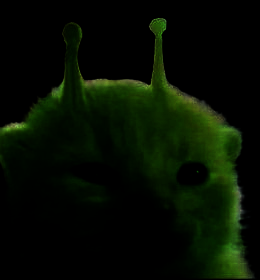
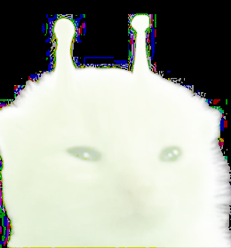
je les ai fait avec deux methodes mais je pourrais les faires sur qu'une seule (il faudrait juste mettre le facteur d'eclaircissement/d'assombrissement en parametre) j'ai globalement fait ca pour toutes les fonctions. 
## Exercice 11: disque(thatsallpouet):
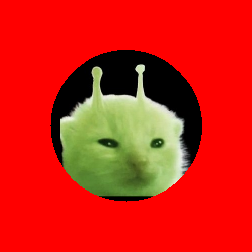
en voulant creer le disque j'ai tout d'abord réalisé le cercle. Ca ma demandé un peu de reflection et différente idée pour le faire m'ont traversé l'esprit (notamment à un moment ou je me retrouvais avec des quarts)
## Exercice 12: cercle(snipepouet):

je n'ai pas eu de souci pour cet exercice (j'ai également réalisé la rosace mais je ne l'ai pas inclus dans mon code car pas assez "propre" au niveau du code)
## Exercice 13:mosaique(pouetpouetarmy):
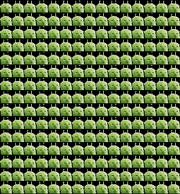
j'ai eu beaucoup de mal au niveau de la comprehension du modulo dans le code mais la reflexion et visualisation au tableau m'a permis de reussir l'effet 
## Exercice 14:mosaique miroir(pouetteuoparmy):
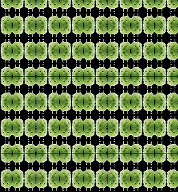
pareil que pour la mosaique
## Exercice 15:glitch(pA'uAct):
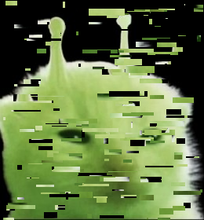
celui ci m'a paru bien plus simple que les précedents et ne m'a pas posé de difficulté
## Exercice 16:tri de pixels(pouetpuree):
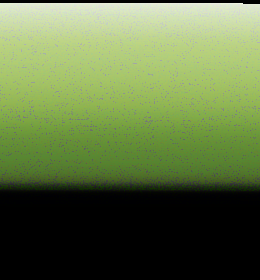
je n'ai pas eu de réel souci avec celui ci
## Exercice 17:histogramme(histopouet):
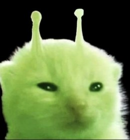
le rendu n'est pas terrible sur cette image mais le code fonctionne. l'explication avec le professeur m'a permis de comprendre mieux l'enoncé et de reussir l'exercice
## Exercice 18:vortex(pouetail):
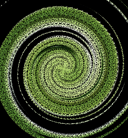
j'ai eu beaucoup de mal à comprendre comment utilisé la fonction rotated et surtout comment l'accentué avec "distance" pour si le pixel était éloigné du centre.
## Exercice 19:convolution(pouetpasnet):
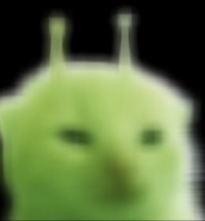
la video à parfaitement expliqué comment le faire doncje n'ai pas eu de réel souci avec celui ci

## Conclusion:
en conclusion je dois quand meme bien relire mon code car j'ai beaucoup eu de petites erreurs qui m'ont fait perdre du temps et dont une relecture aprofondie aurait pu les révéler. j'ai egalement je pense finit de comprendre réelement la notion des pixels et plus précisement de l'utilisation des couleurs qu'à la fin (ce qui se remarque par une grosse présence de .r .g .b enchainé dans mes codes plutot que d'appeler directement le pixel pour le modifier)

## Perso:
## diagopouet:
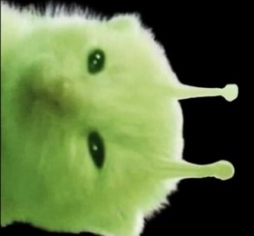
réalise une symetrie à partir de la diagonale
## anarpouet:
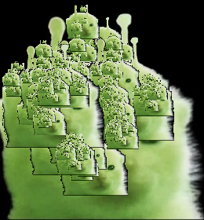
fusion de la fonction mosaique et glitch:
de glitch le positionnement aléatoire de l'image par dessus celle grand format
de mosaique la réduction de l'image (aleatoirement ici)pour ne pas cacher totalement l'image de fond
j'ai aussi rajouter une condition tel que si le pixel de l'image réduite est trop sombre, il n'est pas rajouté à l'image.